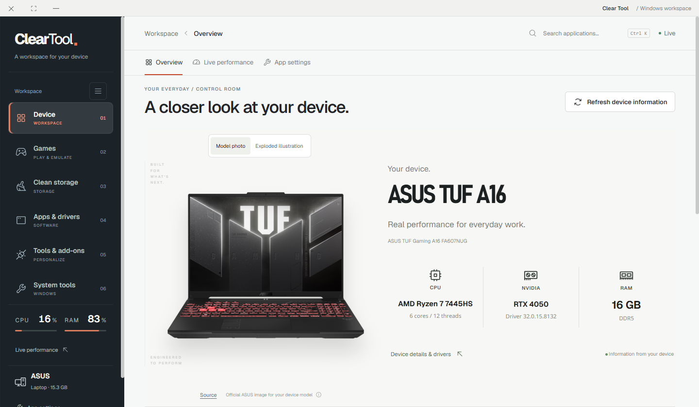
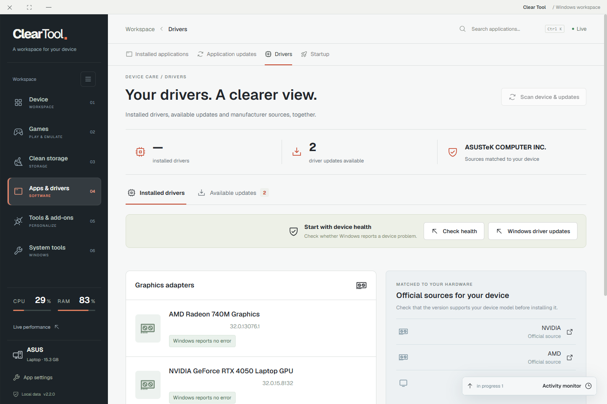
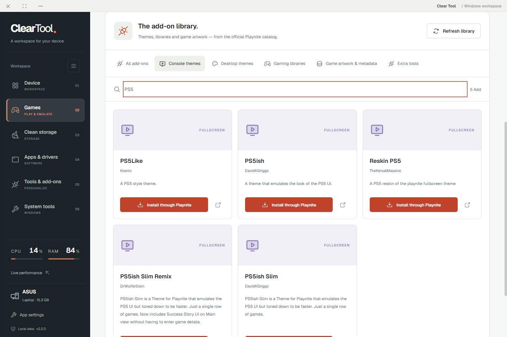
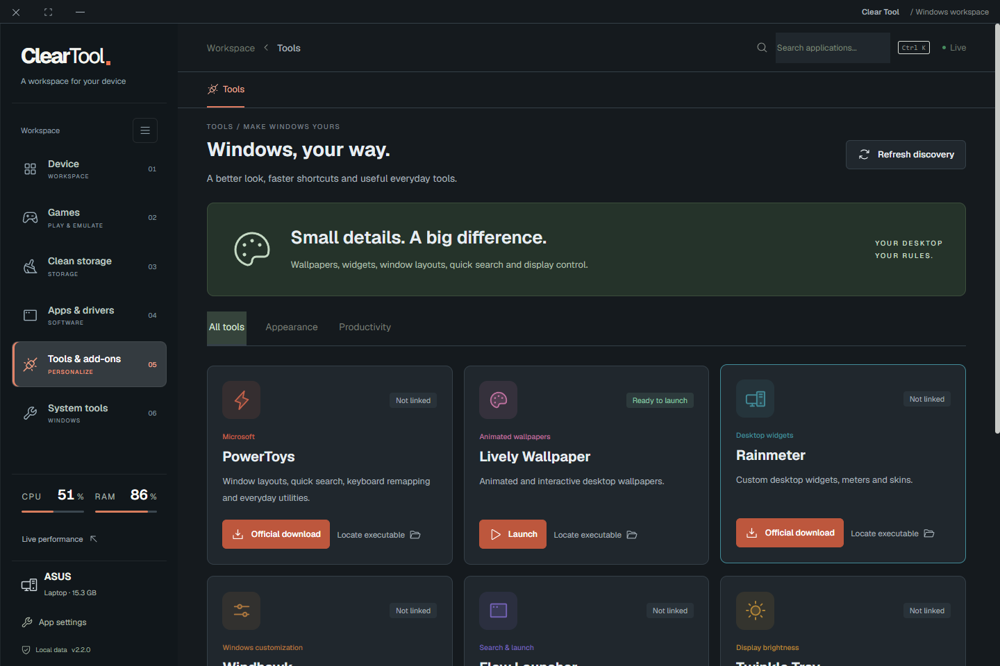

<div align="center">


# Clear Tool

### A clearer view of your Windows PC.

Hardware. Games. Storage. Updates. One organized workspace.

[](https://github.com/Ahmed-Khalil-Mohamed/clear-tool/releases/latest)
[](LICENSE)


**[Download](https://github.com/Ahmed-Khalil-Mohamed/clear-tool/releases/latest) · [العربية](docs/README.ar.md) · [User guide](docs/USER-GUIDE.md) · [Report an issue](https://github.com/Ahmed-Khalil-Mohamed/clear-tool/issues/new/choose)**



</div>

Clear Tool is an independent, open-source Windows desktop application for understanding your PC and handling everyday maintenance. See what is installed, review available updates, organize your games and inspect reclaimable cache space from one bilingual interface.

**You choose the action.** Scans show their results before cleanup or updates. Progress comes from completed work or reported download bytes; when an operation cannot report a percentage, the app says it is still working.

## Download & start

Get the Windows x64 files from **[GitHub Releases](https://github.com/Ahmed-Khalil-Mohamed/clear-tool/releases/latest)**. No account is required to use Clear Tool.

| File | Choose it when… |
| --- | --- |
| **Clear-Tool-Setup-2.2.0.exe** | You want the guided installer and shortcuts. Recommended for regular use. |
| **Clear-Tool-Portable-2.2.0.exe** | You prefer to run without installing. Keep it in a writable folder; settings are stored beside it in `ClearTool-Data`. |
| **SHA256SUMS.txt** | You want to verify the downloaded files. See the [guide](docs/USER-GUIDE.md#verify-a-download). |
| Source code (zip / tar.gz) | You want to inspect or build the code. This is not the Windows installer. |

1. Download the installer or portable file.
2. Open it and let the initial hardware, application and runtime scan finish.
3. Choose **App settings** for English/Arabic, light/dark appearance and background behavior.
4. Open a workspace and review its scan before applying an action.

**Compatibility:** Windows 10/11 x64 is the target. Native testing has been performed on Windows 11 x64; this is not certification for every PC. WinGet/App Installer is required for application update checks. Some Windows operations need administrator approval. No ARM64, macOS or Linux binary is provided.

The release is **not code-signed with a commercial publisher certificate**. Windows may display an unrecognized-publisher warning. Verify the source and checksum; you do not need to disable Windows security.

## Why use Clear Tool?

| What you want to do | What Clear Tool provides |
| --- | --- |
| Understand your device | Detected model, CPU, GPU, RAM, disks and live performance readings. Device-family artwork adapts to the machine. |
| Find space worth reclaiming | Review seven defined cache categories, inspect folder sizes and compare duplicate file contents. Cleanup requires confirmation; duplicates are not deleted automatically. |
| Keep software in view | Installed application inventory, versions and registered paths; WinGet update checks and individual upgrades. |
| Review drivers & Windows updates | Installed driver inventory and compatible updates reported by Windows Update, with timestamps and separate driver/system views. |
| Bring games together | Steam/Epic/registered game discovery, local covers, favorites, shortcuts and a fullscreen ClearPlay library. |
| Explore Playnite & emulation | Live Playnite add-on catalog, desktop/fullscreen launch, emulator linking and local game-file shortcuts. |
| Personalize your workspace | Arabic/English, light/dark themes, compact navigation, tray mode, startup and a shortcuts widget. |
| Reach useful Windows tools | Integrations with PowerToys, Lively, Rainmeter, Windhawk, Flow Launcher and Twinkle Tray, plus Windows settings shortcuts. |

Additional workspaces cover network adapters, native Windows VPN profiles, security status, startup entries, Windows repair tools and a local operation history. Advanced network controls have [specific limits](docs/USER-GUIDE.md#network-and-vpn).

Clear Tool does not promise an FPS increase, recover a fixed amount of space, replace a VPN service or bundle games and BIOS files.

## See it in action

### Drivers, with the context you need

Installed inventory and available updates have separate views. Update availability comes from Windows Update, not an assumption based on a driver's age. Installation continues in Windows Update.



### Playnite add-ons, easier to explore

Browse by category, search themes and extensions, then hand the selected add-on to Playnite for installation. Playnite must be installed and its protocol registered. Catalog availability changes over time.



### Your language. Your theme.

Arabic with right-to-left layout or English with left-to-right layout. Preferences persist between sessions and apply to the widget.



These are screenshots of the native 2.2 application. Hardware, usage figures and available updates shown belong to a test session and will differ on your PC. See [image provenance](docs/images/README.md).

## What's new in 2.2

- A redesigned driver and update center with search, version comparisons and clear operation states.
- WinGet download progress in the app and Windows taskbar using ConPTY output.
- Windows Update discovery, including compatible driver packages.
- A live Playnite add-on catalog with installation handoff.
- An official ASUS FA607NUG exterior photo for that exact detected model, alongside the labeled illustrative view.
- Arabic/English and light/dark workspaces, improved sidebar, emulation links and Windows tools.

Read the [release notes](docs/releases/v2.2.0.md) and [changelog](CHANGELOG.md).

## Privacy & deliberate actions

Device scans, settings and history are stored locally. Clear Tool has no analytics or account system. Online features contact Windows Update, WinGet, Playnite or official vendor pages. User-requested exports may contain device information and paths: review them before sharing.

Cache cleanup is permanent after confirmation. The app skips changed, locked and out-of-scope files; it does not target personal documents, game folders, DriverStore or WinSxS. No registry-cleaner or partition-resizing feature is included. See [privacy](docs/PRIVACY.md) and the [usage guide](docs/USER-GUIDE.md).

## Build from source

Use a supported **Node.js 22 LTS release at least 22.12**, npm, Git and Windows x64.

```powershell
git clone https://github.com/Ahmed-Khalil-Mohamed/clear-tool.git
cd clear-tool
npm ci
npm test
npm run build
npm start
```

Create the portable app and installer:

```powershell
npm run package
```

Outputs are placed in `release/2.2.0/`. For live frontend development, run `npm run dev` in one terminal, then `$env:CLEAR_DEV_URL='1'; npm start` in another. Browser-only previews cannot inspect Windows hardware.

Built with React, Vite, Electron, PowerShell/CIM and node-pty. The renderer uses context isolation and sandboxing with a named IPC API. See [contributing](CONTRIBUTING.md) for the project layout and verification workflow.

## Contribute & share

Bug reports, reproducible compatibility reports, translations and small focused pull requests are welcome. Use the [issue templates](https://github.com/Ahmed-Khalil-Mohamed/clear-tool/issues/new/choose), and remove personal paths or identifiers from reports.

Want to introduce the project? The [launch kit](docs/LAUNCH-KIT.md) includes ready-to-share Arabic/English copy and screenshot paths.

## License & credits

Project code is available under the **[MIT License](LICENSE)**. Third-party software, fonts, trademarks and vendor photographs retain their own terms; see [THIRD-PARTY.md](THIRD-PARTY.md). Device illustrations are labeled conceptual art, not verified service diagrams. Clear Tool is not affiliated with Microsoft, ASUS, Playnite or the other referenced vendors.
