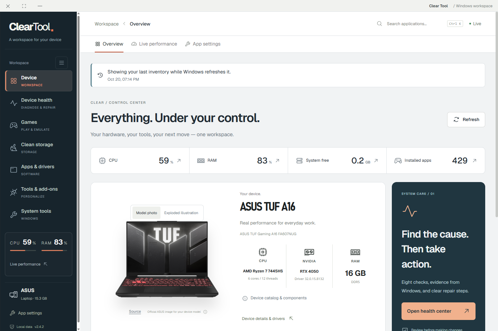
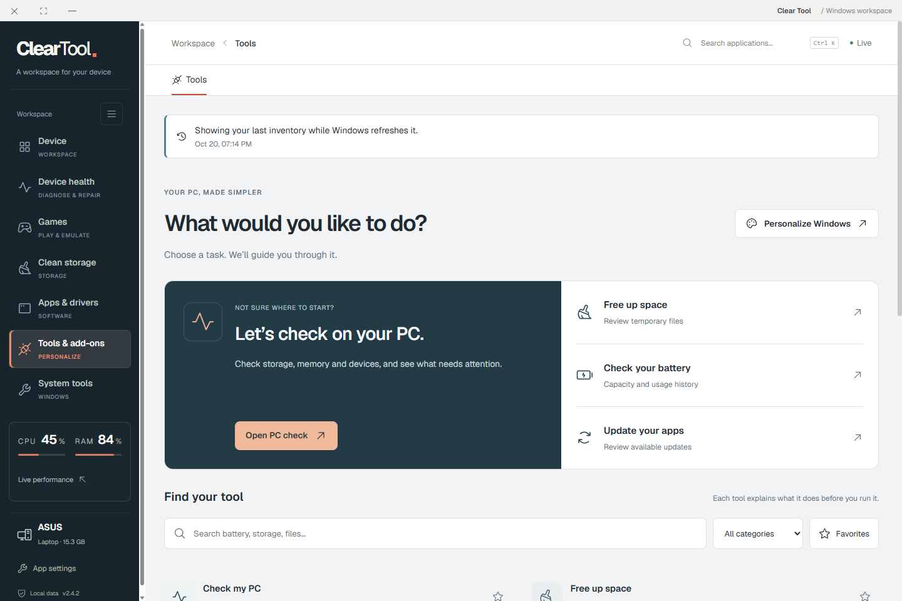
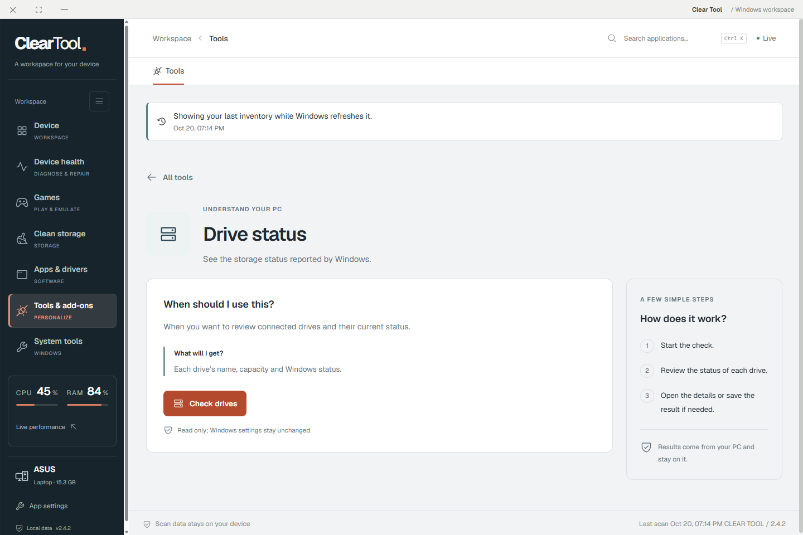
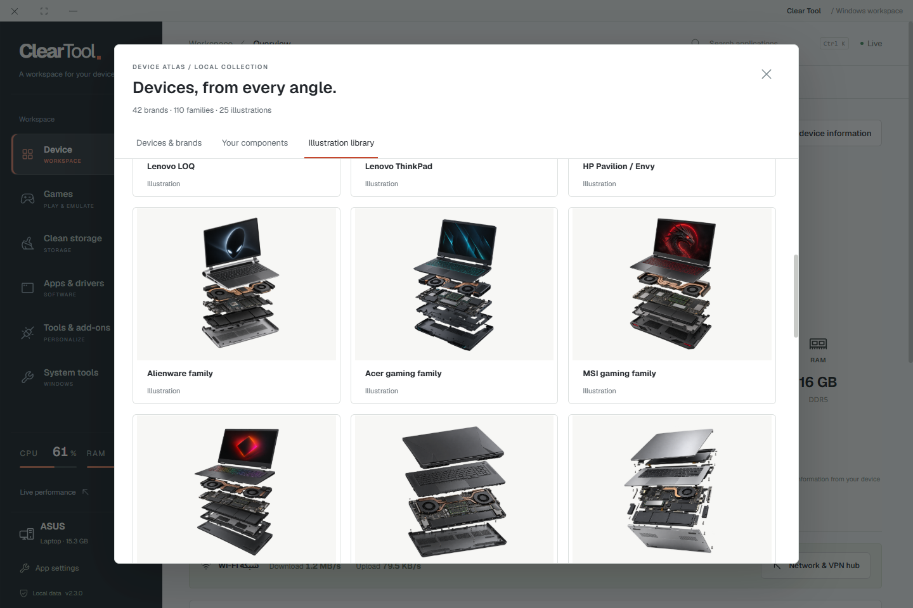
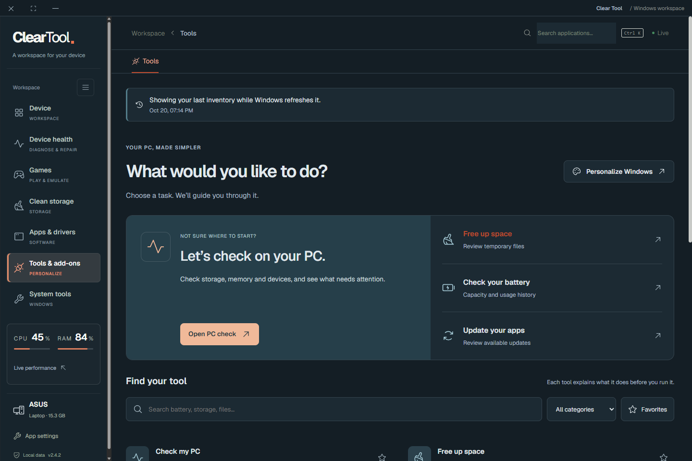

# Clear Tool

**[إعلان الإطلاق والمناقشة](https://github.com/Ahmed-Khalil-Mohamed/clear-tool/discussions/1)** — شاهد المزايا وشارك رأيك واقتراحاتك.

### نظرة أوضح لجهازك. مساحة واحدة لإدارته.

مواصفات الجهاز، الألعاب، المساحة، البرامج والتحديثات — في تطبيق ويندوز بالعربية والإنجليزية.

**[تنزيل أحدث إصدار](https://github.com/Ahmed-Khalil-Mohamed/clear-tool/releases/latest) · [English](../README.md) · [دليل الاستخدام](USER-GUIDE.ar.md) · [الإبلاغ عن مشكلة](https://github.com/Ahmed-Khalil-Mohamed/clear-tool/issues/new/choose)**

Clear Tool مشروع مستقل ومفتوح المصدر يجمع أدوات متابعة الجهاز والصيانة اليومية في واجهة منظمة. اعرف الموجود على جهازك، راجع التحديثات المتاحة، نظّم ألعابك، وافحص الكاش قبل ما تقرر تنظّفه.

## الجديد في 2.4.2

الإصدار ده يجمع كل التعديلات بعد 2.3، بما فيها شغل 2.4.0 و2.4.1 اللي كان محليًا:

- **أدوات أبسط:** بداية حسب المهمة، بحث ومفضلة، وشرح وخطوات وزر واضح لكل أداة جديدة.
- **٦ أدوات محلية:** مقارنة بصمة الملف، تقرير البطارية، الشحن الحالي، حالة الأقراص، السكون، ومراجعة الخدمات؛ مع نتائج مفهومة وتفاصيل وتصدير.
- **فحص صحة الجهاز:** ٨ فحوصات للقراءة فقط، أدلة وتقرير محفوظ، والوصول لأدوات الإصلاح بعد المراجعة.
- **التحميلات والتحقق:** مراجعة ٦ حزم أدوات، متابعة التثبيت والتحديث، التحقق من الإصدار المثبّت، وسجل آخر ٣٠ عملية.
- **تحسين الأداء:** فتح أسرع عند وجود قراءة جهاز محفوظة وصالحة، تحديثها في الخلفية، وتأجيل الفحوصات غير المطلوبة وإيقاف المتابعة غير المستخدمة.
- **نتائج أدق:** استبعاد الملفات المتغيّرة أثناء فحص التكرارات، وعدم اعتبار البيانات الناقصة نتيجة سليمة.

[تفاصيل الإصدار وطريقة التحديث](releases/v2.4.2.md) · [شرح الأدوات](CONTROL-CENTER.md) · [الفحص الشامل](HEALTH-CENTER.md) · [التحميلات والتحقق](DOWNLOADS.md)

## سابقًا في 2.3 — كتالوج الأجهزة

٤٢ ماركة و١١٠ سلاسل أجهزة و٢٥ رسمًا توضيحيًا، مع البحث والفلترة والاختيار التلقائي أو اليدوي. من الرئيسية افتح **كتالوج الأجهزة والقطع** لمشاهدة المكتبة وبيانات المكوّنات المتاحة من ويندوز. الرسومات تمثيلية وليست صورًا موثّقة لكل موديل. [حصر التغطية](DEVICE-ATLAS.md).

## التنزيل والتشغيل

من [صفحة الإصدارات](https://github.com/Ahmed-Khalil-Mohamed/clear-tool/releases/latest)، اختار:

- **Clear-Tool-Setup-2.4.2.exe:** معالج تثبيت واختصارات؛ الأنسب للاستخدام اليومي.
- **Clear-Tool-Portable-2.4.2.exe:** تشغيل بدون تثبيت؛ الإعدادات في مجلد `ClearTool-Data` بجانب الملف، فلازم يكون المكان قابلًا للكتابة.
- **SHA256SUMS.txt:** بصمات التحقق من ملفات التحميل.

ملفات Source code مخصصة للمطورين، وليست مثبت البرنامج. بعد أول تشغيل، انتظر قراءة الجهاز ثم اختار اللغة والثيم من الإعدادات. الاستخدام لا يحتاج حسابًا.

المستهدف Windows 10/11 بمعمارية x64. الاختبار الفعلي كان على Windows 11؛ لم يُختبر على كل الأجهزة. تحديث البرامج يحتاج WinGet / App Installer، وبعض أدوات ويندوز تطلب صلاحية مسؤول. النسخة غير موقّعة بشهادة نشر تجارية وقد يظهر تنبيه ناشر غير معروف؛ راجع المصدر وبصمة الملف، بدون تعطيل حماية ويندوز.

## البرنامج بيساعدك في إيه؟

| الاستخدام | الموجود في Clear Tool |
| --- | --- |
| تعرف جهازك | الموديل والمعالج وكارت الشاشة والرام والأقراص وقراءات الأداء. |
| تفهم المساحة | فحص 7 فئات كاش محددة، أحجام المجلدات ومقارنة التكرارات بالمحتوى. لا حذف تلقائي للتكرارات. |
| تراجع البرامج | الأسماء والإصدارات والمسارات المسجّلة، وفحص تحديثات WinGet وتحديث كل برنامج على حدة. |
| تراجع التعريفات | فصل المثبّت عن المتاح، وفحص تحديثات متوافقة عبر Windows Update؛ التثبيت يكمل من ويندوز. |
| تنظم ألعابك | اكتشاف مكتبات ألعاب، أغلفة محلية، مفضلة واختصارات، ووضع ClearPlay بملء الشاشة. |
| تستخدم Playnite والمحاكيات | كتالوج إضافات مباشر، ثيمات ووضع كونسول، وربط محاكيات وملفات ألعابك المحلية. |
| تخصص ويندوز | روابط وأدوات PowerToys وLively وRainmeter وغيرها، مع ثيم فاتح وداكن وواجهة عربية وإنجليزية. |

كمان فيه متابعة الشبكة وVPN ويندوز الموجود، أدوات بدء التشغيل والحماية وإصلاح ويندوز، وأيقونة قرب الساعة وويدجت للاختصارات.

## الجديد في 2.2

- تصميم جديد للتعريفات والتحديثات، مع بحث وحالات واضحة.
- نسبة تحميل فعلية عندما يوفّرها WinGet، داخل البرنامج وعلى شريط المهام؛ التثبيت مرحلة منفصلة.
- فحص تحديثات ويندوز والتعريفات المتوافقة مع وقت آخر فحص.
- كتالوج إضافات Playnite قابل للبحث، وزر يسلم التثبيت إلى Playnite.
- صورة رسمية لموديل ASUS FA607NUG عند اكتشافه، مع عرض تفكيكي توضيحي اختياري.

الصور من التطبيق الفعلي؛ الأرقام والمواصفات والتحديثات مثال من جلسة اختبار وستختلف على جهازك. رسومات عائلات الأجهزة توضيحية، وليست صورًا دقيقة لكل موديل.

## تحكم واضح وبيانات محلية

البرنامج يعرض نتيجة الفحص قبل إجراءات التنظيف والتحديث. حذف الكاش نهائي بعد التأكيد، والملفات المشغولة أو المتغيرة تُتخطّى. لا يستهدف المستندات أو مجلدات الألعاب، ولا يحتوي Registry Cleaner أو تقسيم بارتشنات.

لا يوجد حساب أو تحليلات استخدام. بيانات الفحص والإعدادات والسجل محلية؛ المزايا المتصلة تستخدم Windows Update وWinGet وPlaynite والمصادر الرسمية. راجع تقارير التصدير قبل نشرها لأنها قد تحتوي مسارات ومعلومات جهازك.

لا نعد بزيادة FPS أو توفير حجم ثابت من المساحة. البرنامج لا يوزّع ألعابًا أو BIOS، ولا يقدم خدمة VPN جديدة. إضافات Playnite والمحاكيات لها متطلبات وشروط مستقلة.

## للمطورين والمساهمين

الكود برخصة [MIT](../LICENSE). الخطوط والمكونات وصور الشركات لها حقوقها وشروطها الموضحة في [الاعتمادات](../THIRD-PARTY.md).

تعليمات البناء في [README الإنجليزي](../README.md#build-from-source)، ودليل المساهمة في [CONTRIBUTING](../CONTRIBUTING.md). للإعلان عن المشروع استخدم [حزمة الإطلاق](LAUNCH-KIT.md).

